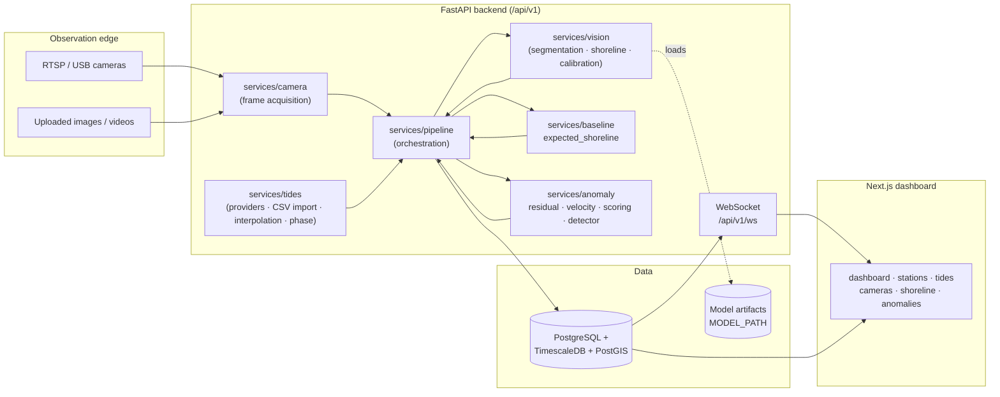
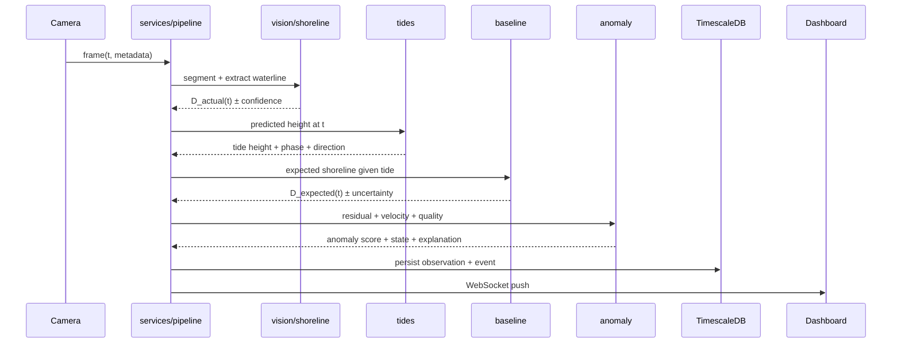

# CoastWatch Architecture

> A tide-aware shoreline monitoring and tsunami-drawdown **anomaly detection**
> platform. This is a research and decision-support system. It does **not**
> confirm a tsunami and is **not** an operational warning service. PHIVOLCS
> advisories remain authoritative.

Primary region: **Philippines**. The design supports multiple countries
(Southeast Asia) without assuming shared tide data formats, time zones,
vertical datums, or prediction services.

---

## 1. High-level components



---

## 2. Data flow

The end-to-end flow, and the module that owns each step:

```
camera frame ──▶ services/camera/*            acquire + quality-check frame
             ──▶ services/vision/shoreline.py  extract waterline  ("where is the waterline NOW")
             ──▶ services/tides/*              predicted tide height at the timestamp
             ──▶ services/baseline/expected_shoreline.py
                                               expected waterline  ("where SHOULD it be, given the tide")
             ──▶ services/anomaly/*            residual, velocity, score, system state
             ──▶ PostgreSQL/TimescaleDB        persist observation + event
             ──▶ WebSocket ──▶ Next.js         live dashboard + alerts
```



Sign convention: **positive shoreline distance is seaward**, so
`R(t) = D_actual(t) − D_expected(t) > 0` means the observed waterline is farther
offshore than the tide alone would explain.

---

## 3. Module boundaries (explicit, enforced)

| Question | Owned by | Phase |
|---|---|---|
| Where is the waterline **now**? | `app/services/vision/shoreline.py` | 4 |
| Where **should** the waterline be given the tide? | `app/services/baseline/expected_shoreline.py` | 5 |
| What does the tide say at time *t*? | `app/services/tides/*` | 2 |
| Is the movement anomalous, and why? | `app/services/anomaly/*` | 6 |
| Orchestration of the whole flow | `app/services/pipeline.py` | 4+ |

Rules:

* **Routes never embed the flow.** API handlers call into
  `services/pipeline.py` (and, later, module services) — they do not chain
  camera → vision → baseline → anomaly themselves.
* `vision/shoreline.py` **never** consults the tide or the baseline.
* `baseline/expected_shoreline.py` **never** looks at a camera frame; it maps
  tide → expected shoreline only.
* Modules communicate through documented interfaces
  (`services/*/base.py`, `services/*` dataclasses) and shared DB schemas.

---

## 4. Backend layout

```
backend/app/
├── api/
│   ├── deps.py                 DB session + health helpers + shared deps
│   └── routes/
│       ├── health.py           /health, /health/db
│       ├── stations.py         monitoring stations, tide stations, countries
│       ├── tides.py            tide stations, datasets, CSV import, predictions
│       ├── cameras.py          camera connection, status, frames
│       ├── shorelines.py       observations, calibrations, baselines
│       ├── anomalies.py        events, current state
│       └── websocket.py        /ws realtime channel
├── core/                       config.py, logging.py, exceptions.py, middleware.py
├── database/                   base.py (declarative base), session.py (engine)
├── models/                     SQLAlchemy ORM (one module per domain)
├── schemas/                    Pydantic request/response models
├── services/
│   ├── pipeline.py             orchestration seam (Phase 4+)
│   ├── camera/                 base.py · rtsp.py · usb.py · upload.py · manager.py
│   ├── vision/                 preprocessing · segmentation · shoreline · calibration
│   ├── tides/                  base.py · namria.py · csv_import · interpolation · tide_phase
│   ├── baseline/               expected_shoreline.py
│   └── anomaly/                displacement · velocity · scoring · detector
└── main.py                     FastAPI app factory
```

Phase 1 shipped the versioned API surface; Phase 2 implements the tide engine.
Modules whose logic lands in a later phase still register **explicit phase-stub
endpoints** (HTTP 501 with the target phase) so versioning and the frontend
route map stay stable and nothing is faked.

**Phase 2 status (tide prediction engine): implemented.** `services/tides/`
provides `NAMRIATideProvider` (list stations, preview/commit CSV import with
validation + rejection persistence, range queries, PCHIP/linear interpolation,
extrema detection, high/low water events, rising/falling/slack classification,
current-time and selected-time predictions). The dashboard consumes it through
`/api/v1/tides/*` and `/api/v1/*` station endpoints.

---

## 5. Data model

TimescaleDB **hypertables** (partitioned on their time column; the time column
is part of the primary key, as TimescaleDB requires):

| Table | Time column | Notes |
|---|---|---|
| `tide_predictions` | `timestamp` | Predicted heights (never measured sea level) |
| `shoreline_observations` | `observed_at` | Waterline observations |
| `anomaly_events` | `detected_at` | Detection events + explanations |
| `environmental_observations` | `observed_at` | Waves, wind, rain, visibility |
| `system_health_logs` | `recorded_at` | Camera/data-quality diagnostics |

Regular tables: `countries`, `monitoring_stations`, `tide_stations`,
`tide_datasets`, `dataset_imports`, `cameras`, `camera_calibrations`,
`shoreline_baselines`.

PostGIS `geography(Point, 4326)` columns: `monitoring_stations.location`,
`tide_stations.location`, `cameras.location`.

Key invariants:

* Predicted tide heights are kept **separate** from measured sea levels.
* Each tide station keeps its **own** vertical datum and unit; datums are never
  blended, and the system never silently falls back to an unrelated station.
* Imported datasets and import history are **insert-only** — an imported
  dataset is never overwritten in place.
* Schema changes go through **Alembic only**; `create_all()` is never used in
  runtime paths.

---

## 6. API surface (`/api/v1`)

| Method | Path | Phase | Status |
|---|---|---|---|
| GET | `/health` | 1 | ✅ implemented |
| GET | `/health/db` | 1 | ✅ implemented |
| GET | `/ws` | 1 (plumbing) | ✅ implemented |
| GET | `/countries` | 2 | ✅ implemented |
| POST/GET | `/stations` | 2 | ✅ implemented |
| GET/POST | `/tides/stations`, `/tides/predictions`, `/tides/current`, `/tides/at`, `/tides/chart`, `/tides/high-low-waters`, `/tides/imports*` | 2 | ✅ implemented |
| GET | `/cameras` | 3 | ✅ implemented |
| GET | `/shorelines` | 4 | ⏳ phase stub (501) |
| GET | `/anomalies` | 6 | ⏳ phase stub (501) |

See `docs/API_DOCUMENTATION.md` for details.

---

## 7. Deployment

`docker compose up --build` starts:

* `db` — `timescale/timescaledb-ha:pg16` (TimescaleDB + PostGIS), healthcheck
  via `pg_isready`.
* `backend` — FastAPI image; the entrypoint waits for the DB, runs
  `alembic upgrade head`, then serves uvicorn on `:8000`.
* `frontend` — Next.js standalone server on `:3000`.

Every service has a healthcheck and dependencies wait for `service_healthy`.
GPU/edge (Jetson Orin Nano, Phase 9) adds ONNX Runtime and local buffering.

---

## 8. Multi-country design

Adding a country means adding: a `countries` row, a tide provider
(`services/tides/`), and per-station time zone / datum / unit metadata. Nothing
in the anomaly engine is keyed to Philippine-specific values or a single tide
service.
