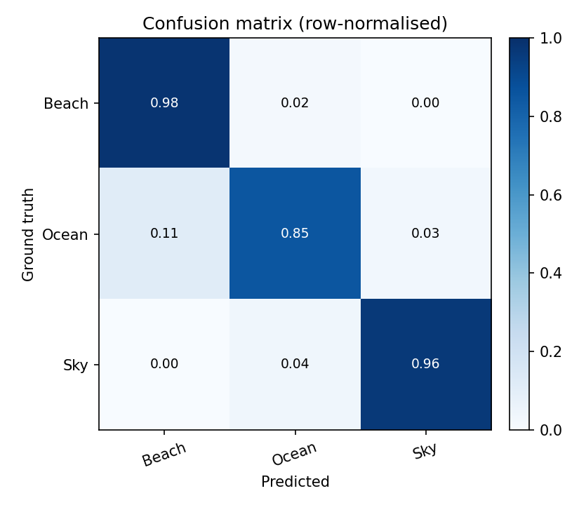
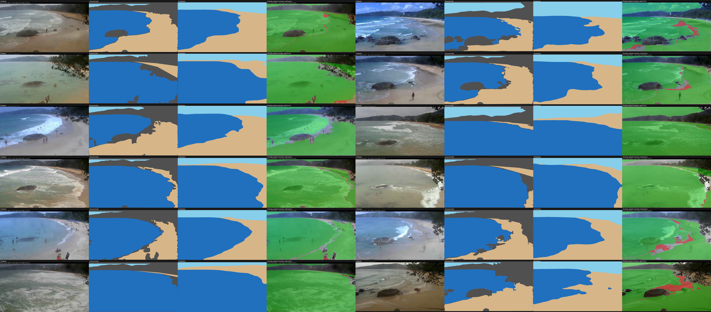

# CoastWatch SegFormer Evaluation

Generated: `2026-11-25T06:52:38.930195+00:00`

- Checkpoint: `C:\Users\bitui\Documents\coastwatch\ml\checkpoints\segformer_b2\best.pt`
- Split: `test` (100 images)
- Metric resolution: native image resolution after logit upsampling

## Primary metrics

Beach IoU and shoreline MAE are the primary quality signals for the application. Mean IoU is retained for continuity but is dominated by the large, easy Ocean and Sky classes.

| metric | value |
|---|---:|
| Beach IoU | 0.8616 |
| Shoreline MAE, mean | 27.9654 px |
| Shoreline MAE, median | 12.4846 px |
| Shoreline MAE, p95 | 101.6397 px |
| mean IoU (dominated by easy classes) | 0.8478 |

## Overall test metrics

| class | IoU | Dice | precision | recall | support px |
|---|---:|---:|---:|---:|---:|
| Beach | 0.8616 | 0.9257 | 0.9131 | 0.9385 | 27,485,659 |
| Ocean | 0.7820 | 0.8776 | 0.9079 | 0.8493 | 35,125,611 |
| Sky | 0.8998 | 0.9472 | 0.9305 | 0.9646 | 41,111,677 |
| **mean (dominated by easy classes)** | **0.8478** | **0.9168** | | | **103,722,947** px |

Pixel accuracy: **0.9186**

## Confusion matrix

## Condition coverage (image-statistics heuristics)

These tags are **not** ground-truth weather labels. They are derived from luminance, glare and saturation. A condition with zero images is not represented and must not be claimed as supported.

| tag | images | mean IoU | pixel accuracy |
|---|---:|---:|---:|
| night | 0 | n/a | n/a |
| low_light | 26 | 0.6191 | 0.7688 |
| normal_light | 71 | 0.9058 | 0.9551 |
| bright_sunlight | 3 | 0.9926 | 0.9982 |
| strong_glare | 23 | 0.7970 | 0.9121 |
| overcast_or_low_saturation | 25 | 0.7519 | 0.8588 |
| high_saturation | 0 | n/a | n/a |
| small_beach_visible_fraction | 7 | 0.9761 | 0.9941 |
| ocean_dominant | 8 | 0.9675 | 0.9880 |

Unrepresented condition tags: `night`, `high_saturation`.

## Shoreline extraction

- Predicted shoreline available: 91/100 test images
- GT shoreline available: 91/100
- Mean per-column MAE: 27.9654 px; median: 12.4846 px; p95: 101.6397 px
- Per-column MAE compares only image columns where both the ground-truth and predicted polylines exist. Some frames contain a far shore as well as the near waterline, so the single-valued polyline can switch branches; treat this as an image-space diagnostic, not a physical accuracy claim.
- These are image-pixel distances only. No tide, bathymetry, or metric world-coordinate claim is made.

## Prediction visualisations

Per-image four-panel outputs are in `predictions/`.

## Honest limitations

- Training data: 371 labelled images in the training split (the baseline model used 131). Training masks are automatic SAM3 annotations, so metrics measure agreement with those annotations rather than human ground truth.
- Dataset B (SCLabels, 1,717 images) has no masks and is absent from training.
- The test split contains 100 images; metrics have uncertainty and are not a production or cross-camera accuracy claim.
- Nighttime is supported only if the test split actually contains night images. Check the condition coverage table; do not infer nighttime capability from a daytime-only evaluation.
- Condition tags are luminance/glare/saturation heuristics, not meteorological or tide ground truth. Waves, sea foam, wet sand, vegetation, rocks and tide are not separately annotated or labelled.
- Shoreline error is in image pixels. No camera calibration or world-coordinate conversion was applied, so no metre/tide claim is made.
- Source annotations are SAM3-generated polygons with documented Beach/Ocean overlap and visible coarse boundaries; some annotation noise is inherited.
- The annotation polygons leave the wet-sand swash zone unlabelled in many frames. Those pixels are ignore 255, not Sky. In 6/20 test images the remaining Beach and Ocean polygons do not touch, so no ground-truth shoreline can be extracted and that image is excluded from shoreline error.
- Some frames contain a far shore in addition to the near waterline. The single-valued per-column shoreline can switch branches, so shoreline MAE is an image-space diagnostic reported over shared columns, not a physical accuracy claim.

## Per-image worst cases (by mean IoU)

| image | mean IoU | Beach IoU | Ocean IoU | Sky IoU | tags |
|---|---:|---:|---:|---:|---|
| `site_usa_turquoise_beach_alabama_2026-11-24_17-34-00.png` | 0.4262 | 0.9204 | 0.0065 | 0.3519 | low_light, overcast_or_low_saturation |
| `site_usa_turquoise_beach_alabama_2026-11-24_17-44-00.png` | 0.4325 | 0.9758 | 0.0000 | 0.3216 | low_light, overcast_or_low_saturation |
| `site_usa_turquoise_beach_alabama_2026-11-24_18-54-00.png` | 0.4361 | 0.9732 | 0.0000 | 0.3349 | low_light, overcast_or_low_saturation |
| `site_usa_turquoise_beach_alabama_2026-11-24_19-34-00.png` | 0.4427 | 0.9310 | 0.0231 | 0.3741 | low_light, overcast_or_low_saturation |
| `site_usa_turquoise_beach_alabama_2026-11-24_19-14-00.png` | 0.4431 | 0.9404 | 0.0174 | 0.3715 | low_light, overcast_or_low_saturation |
| `site_usa_turquoise_beach_alabama_2026-11-24_19-24-00.png` | 0.4457 | 0.9787 | 0.0097 | 0.3486 | low_light, overcast_or_low_saturation |
| `site_usa_turquoise_beach_alabama_2026-11-24_19-04-00.png` | 0.4517 | 0.9849 | 0.0000 | 0.3703 | low_light, overcast_or_low_saturation |
| `site_japan_shirahama_2026-11-25_04-32-00.png` | 0.4522 | 0.4082 | 0.3072 | 0.6413 | low_light |
